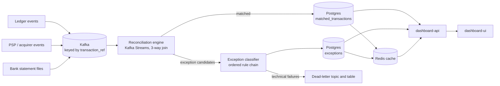

# Real-Time Payment Reconciliation & Exception Engine

**Reconciliation that runs in seconds, not overnight.**

Instant payment rails (FedNow, RTP, UPI-style systems, card authorisations) move money in seconds, but most
finance operations teams still prove that the books are right with a nightly batch job. When something breaks, they
find out the next morning, 12+ hours later. This project treats reconciliation as a **real-time data-consistency
guarantee**: every event from the ledger, the payment processor (PSP) and the bank is matched, or flagged as an
exception with a stated reason, within seconds of arriving.

> It is an observability and consistency system. It does not move money.

---

## Contents

1. [What it does](#what-it-does)
2. [How it works](#how-it-works)
3. [Guarantees and the reasoning behind them](#guarantees-and-the-reasoning-behind-them)
4. [Exception taxonomy](#exception-taxonomy)
5. [The ops console](#the-ops-console)
6. [Tech stack](#tech-stack)
7. [Project status](#project-status)
8. [Run it locally](#run-it-locally)
9. [Repository layout](#repository-layout)
10. [Testing](#testing)
11. [Observability](#observability)
12. [Design decisions](#design-decisions)
13. [Roadmap](#roadmap)
14. [Known limits](#known-limits)

---

## What it does

For every transaction, three independent systems should agree: the **internal ledger**, the **PSP / acquirer**, and
the **bank statement**. The engine joins the three by transaction reference as events arrive and decides one of:

- **Matched**: all sources agree on amount and currency (exactly, or within a configured tolerance).
- **Exception**: sources disagree or one never showed up. The system records *which rule fired and what it compared*,
  keeps the raw events from every source, and puts the case in front of an operator.

Operators work from a live console: how today is going, what needs triage, why a given transaction was flagged, and a
resolve action that leaves an audit trail.

### Out of scope for v1

Real bank/PSP integrations (sources are simulated with realistic event contracts), multi-currency FX-adjusted
matching, chargebacks and disputes, and any real money movement.

---

## How it works



1. **Ingest.** Ledger and PSP producers write to Kafka; a file ingester parses bank statement CSVs into Kafka.
   Every topic is keyed by `transaction_ref`, so all events for one transaction land on the same partition, in order.
   The engine's local state never needs a cross-partition join.
2. **Match.** The reconciliation engine (Kafka Streams) holds each transaction in a session window (30 minutes by
   default, configurable), because bank feeds can lag by minutes to hours. An ordered rule chain decides the outcome:
   exact match, match within tolerance, or a timing-only warning for slow settlement.
3. **Persist.** Matches go to a daily-partitioned Postgres table (the source of truth). Anything that does not match
   becomes an *exception candidate* on its own topic.
4. **Classify.** The exception classifier re-derives the cause from the data (never trusting the engine's hint) using
   an ordered rule chain, and writes one auditable row per case. Technical failures take a separate dead-letter path.
5. **Serve.** Redis holds live copies for O(1) lookups and cheap headline metrics. `dashboard-api` reads Redis first,
   falls back to Postgres, and streams new exceptions to the browser. `dashboard-ui` is the operator console.

---

## Guarantees and the reasoning behind them

| Property | How it is achieved |
|---|---|
| **No double-counted settlement** | At-least-once delivery plus idempotent writes. A durable idempotency ledger (`processed_events`) and unique constraints (`(transaction_ref, match_version)` for matches, `candidate_id` for exceptions) turn a redelivery into a no-op. Kafka's exactly-once transactions are *not* relied on, because they stop at the broker boundary and the system writes to Postgres and Redis. |
| **No silent data loss** | Every event ends in the matched store or the exception queue. Technical failures go to a dead-letter topic (3 retries with 1s/2s/4s backoff) and are persisted for engineering, with an alert on any increase. |
| **Survives restarts** | The engine's windowed state is backed by a compacted changelog topic, so a restarted pod rebuilds it. A plain consumer with an in-memory map was considered and rejected for exactly this reason. |
| **Explainable decisions** | Each exception stores the rule that fired, the values it compared, and the raw events from every source. Regulators and auditors can ask "why did the system say that?" and get an answer. |
| **Replayable** | Kafka retention plus idempotent writes means a day's events can be replayed without side effects. |
| **Redis can fail safely** | Redis is a cache and never the durability boundary. Postgres is written first and Redis second (after commit); Redis errors are logged and treated as a cache miss. If Redis goes down the console gets slower and no data is lost. |

Design targets (not yet load-tested, see [Roadmap](#roadmap)): p95 match latency under 5 seconds, 500 events/sec
sustained with bursts to 2,000/sec, 99.9% ingestion availability.

---

## Exception taxonomy

| Code | Meaning | Detected by |
|---|---|---|
| `MISSING_SOURCE` | Fewer than three sources arrived within the window | Window expiry with an incomplete set |
| `AMOUNT_MISMATCH` | Two or more sources disagree beyond tolerance | Amount comparison across sources |
| `CURRENCY_MISMATCH` | Same reference, different currencies | Checked before amounts (comparing amounts across currencies is meaningless) |
| `DUPLICATE_TRANSACTION_REF` | Same source, same reference, different event id: two genuine transactions claiming one reference | Distinct event ids from one source |
| `ORPHAN_EVENT` | PSP or bank saw a reference the ledger never recorded, even after a grace period | Scheduled sweep upgrades `MISSING_SOURCE` after the grace period |
| `LATE_ARRIVAL` | An event arrives after the transaction was already resolved | Folded into the existing open exception for audit instead of creating a fresh one |
| `UNCLASSIFIED` | Safety net: nothing matched | Alerts engineering; never dropped |

Two different queues, deliberately: **business exceptions** are expected operational noise and go to the ops team;
**dead letters** are technical failures and go to engineering.

---

## The ops console

`dashboard-ui` (React) over `dashboard-api` (Spring Boot).

| Screen | What it is for |
|---|---|
| **Overview** | Matched vs exception tally for a date, settlement lag (median, p95, p99, average), exceptions by cause, open backlog, engine health (a cell per partition), and a live feed with matches per second |
| **Exceptions** | Triage list filtered by status (Open by default) and cause. New arrivals appear as a banner so rows never move while someone is reading |
| **Exception detail** | Each source's amount, currency and time side by side with differences highlighted, a missing source shown as "No event", which rule fired and why, raw events, and the resolve form |
| **Find a transaction** | Status, cause and sources for one reference, and whether the answer came from the cache or the database |

API (`dashboard-api`, port 8086): `GET /api/v1/metrics/summary`, `GET /api/v1/exceptions`,
`GET /api/v1/exceptions/{id}`, `POST /api/v1/exceptions/{id}/resolve`, `GET /api/v1/transactions/{ref}`,
`GET /api/v1/stream/live` (Server-Sent Events), `GET /api/v1/engine/health`, `GET /actuator/prometheus`.

---

## Tech stack

| Layer | Choice |
|---|---|
| Language / framework | Java 21, Spring Boot 3, Spring Data JPA, Spring Kafka |
| Streaming | Apache Kafka, Kafka Streams, Avro event contracts with Schema Registry |
| Data | PostgreSQL (daily range partitioning), Redis |
| Frontend | React 18, TypeScript, Vite, TanStack Query, React Router |
| Observability | Micrometer, Prometheus alert rules, Grafana (planned) |
| Local infrastructure | Docker Compose: Kafka, Schema Registry, Kafka UI, Postgres, Redis, LocalStack (S3) |
| Delivery (planned) | Kubernetes, Jenkins |
| Tests | JUnit 5, Mockito, Testcontainers, Vitest, React Testing Library |

Each service is its own Spring Boot application with its own image, so it can be scaled and deployed independently.

---

## Project status

| Phase | Deliverable | Status |
|---|---|---|
| 0 | Local infrastructure (Kafka, Postgres, Redis, Schema Registry, LocalStack, Kafka UI) | Done |
| 1 | Shared event contracts (`common-events`) | Done |
| 2 | Ledger, PSP and bank-file simulators | Done |
| 3 | Reconciliation engine: topology and matching rule chain | Done |
| 4 | Idempotency layer and duplicate-handling tests | Done |
| 5 | Exception path: classifier, `exceptions` table, dead-letter wiring | Built and tested |
| 6 | Redis caching layer and `dashboard-api` | Built and tested; end-to-end verification in progress |
| 7 | `dashboard-ui` (overview, triage, drill-down, resolve) | Built; 34 UI tests pass |
| 8 | Dockerise everything, full-stack smoke test | Planned |
| 9 | Kubernetes manifests (kind/minikube) | Planned |
| 10 | Jenkins pipeline, Prometheus and Grafana dashboards | Planned |
| 11 | Load and resilience testing, architecture decision records | Planned |

---

## Run it locally

**Prerequisites:** JDK 21, Maven 3.9+, Docker with Compose, Node.js 20+.

```bash
# 1. Infrastructure: Kafka, Schema Registry, Kafka UI, Postgres, Redis, LocalStack
docker compose up -d
docker compose ps            # wait until kafka is healthy (it can take a minute after a restart)

# 2. Build and install the shared module and services into your local Maven repo
mvn -pl dashboard-api -am install -DskipTests
mvn -pl exception-classifier -am install -DskipTests

# 3. Start services (one terminal each). Run `install` first: `-am` with spring-boot:run fails on the parent pom.
mvn -pl reconciliation-engine spring-boot:run
mvn -pl exception-classifier  spring-boot:run     # port 8085
mvn -pl dashboard-api         spring-boot:run     # port 8086
# start the simulators from their modules to generate traffic

# 4. The console
cd dashboard-ui && npm install && npm run dev      # http://localhost:3000
```

| Component | Address |
|---|---|
| Ops console | http://localhost:3000 |
| dashboard-api | http://localhost:8086 (`/actuator/health`, `/actuator/prometheus`) |
| exception-classifier | http://localhost:8085 |
| Kafka UI | http://localhost:8080 |
| Schema Registry | http://localhost:8081 |
| Postgres / Redis / Kafka | 5432 / 6379 / 9092 |

Each module has its own README with configuration, endpoints and tests: `exception-classifier/`, `dashboard-api/`,
`dashboard-ui/`.

**Troubleshooting:** if Kafka reports "unhealthy" right after Docker restarted, it is usually recovering its logs
after an unclean shutdown. Watch `docker logs -f recon-kafka` and do not delete its volume.

---

## Repository layout

```
payment-reconciliation-engine/
├── pom.xml                      parent, dependency management
├── docker-compose.yml           local infrastructure
├── common-events/              Avro schemas, shared exception contract, shared Redis keys and status codec
├── ledger-simulator/            generates ledger events
├── psp-simulator/               generates PSP events with delay and failure injection
├── bank-file-ingester/          bank statement files to Kafka
├── reconciliation-engine/       Kafka Streams topology, matching rules, write-through to Redis, heartbeat
├── exception-classifier/        rule-chain classification, exceptions table, dead-letter path, orphan sweep
├── dashboard-api/               REST + SSE API, Redis-first reads, resolve with audit trail
├── dashboard-ui/                React ops console (served by nginx in its image)
├── monitoring/alerts/           Prometheus alert rules
└── docs/adr/                    architecture decision records
```

---

## Testing

| Layer | What is covered |
|---|---|
| Unit | Matching rules, classification rules (one test per rule, including ordering and tolerance boundaries), metrics service, transaction lookup, drill-down diff |
| Integration (Testcontainers) | Real Postgres: a redelivered exception candidate is stored once, a redelivered late arrival is appended once. Real Postgres and Redis: the dashboard API end to end (filters, resolve and conflict handling, cache TTLs, read-through fallback, metrics cache, engine health) |
| Frontend (Vitest) | 34 tests: live-stream hook, formatting, API client errors, every screen including empty, error and conflict states |

The most important single test: publish a duplicate event for an already-matched transaction and assert that no second
settlement is recorded. That is what proves the idempotency story.

---

## Observability

- **Metrics:** exceptions by code, dead letters, orphan upgrades, Redis write failures, cache hit/miss/error counts,
  plus standard JVM, HTTP and Kafka consumer metrics, scraped from `/actuator/prometheus`.
- **Alert rules** (`monitoring/alerts/`): any dead letter, any `UNCLASSIFIED` exception, exception rate above 5% of
  volume, Redis unreachable, Redis writes failing, low cache hit ratio.
- **Engine heartbeat:** every partition the engine owns writes a 30-second heartbeat to Redis; the console shows a
  missing partition as a dashed red cell.

---

## Design decisions

Recorded as architecture decision records in `docs/adr/`. The ones that matter most:

- **Key every topic by `transaction_ref`.** Co-locates a transaction's events so joins stay local. The single most
  important decision in the system.
- **Kafka Streams over plain consumers.** Windowed state and changelog-backed recovery come built in.
- **Idempotency in the database, not only in Kafka.** Effectively-once outcomes where the data finally lands.
- **Session window (30 min) rather than tumbling.** A transaction waits for its late sources instead of being cut at an
  arbitrary boundary.
- **Separate business exceptions from technical failures.** Different owners, different alerting
  (ADR 007).
- **Redis is cache-only, Postgres first then Redis** (ADR 008).
- **The classifier decides the cause from the data.** The engine reports facts, not conclusions, so classification
  logic lives in one place and is testable in isolation.

---

## Roadmap

**Finish the build (phases 8 to 11):** full-stack Docker Compose, Kubernetes manifests with autoscaling for the stateless
API, Jenkins pipeline with Testcontainers integration stage, Grafana dashboards, load tests against the stated
throughput and latency targets, and a chaos test that kills the engine mid-window to prove state recovery.

**Beyond v1:**

- Real PSP and bank integrations (webhooks, polling, statement formats)
- Authentication, roles and real operator identity (the v1 resolve action trusts a name)
- Multi-currency, FX-adjusted matching (the rule chain has a slot for it)
- Acknowledge and reopen actions, assignment and SLAs for exceptions
- Secrets management (Vault or a cloud secrets manager), multi-tenancy
- Trend views and exception analytics

---

## Known limits

- All three sources are **simulated**. Nothing here has been run against real bank or PSP data.
- **No authentication** in v1. The operator name on a resolution is an audit label, not a verified identity.
- Performance figures are **design targets**; load testing is Phase 11.
- The live exception feed is best-effort; the list endpoint is authoritative.
- The console shows rates and totals for the live match feed, not individual matches.
